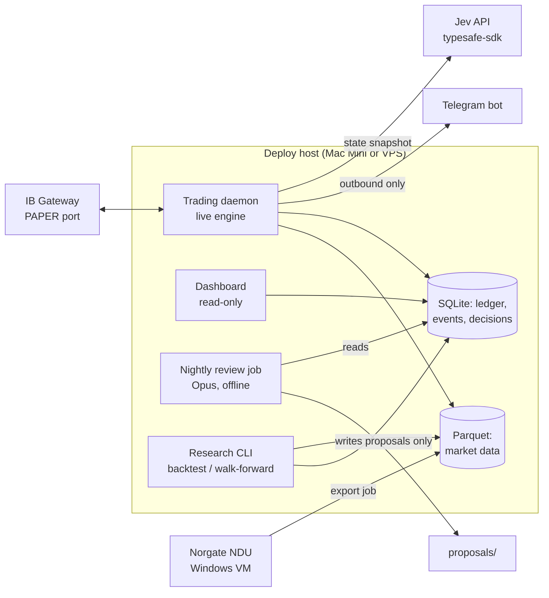

# ARCHITECTURE — Micro Commodity Trend Bot (PAPER ONLY)

Status: **Gate 2 (architecture) — decisions resolved 2026-10-01 (section 10), awaiting final sign-off.** No plan or code until approved.
Source of truth: [`spec.md`](spec.md) (Gate 1 approved 2026-10-01). Where this document and the spec disagree, the spec wins and this document is wrong.

---

## 0. Design principles

1. **One deterministic core, two drivers.** Indicators, state snapshots, signals, sizing, risk checks and roll scheduling are pure functions in one package (`core`). The backtester and the live engine both call the *same* functions. No re-implementation of strategy logic anywhere else. This is the main defence against backtest/live drift.
2. **Fail closed.** Any missing, stale, malformed or unreachable input (calendar, Jev, FX rate, contract details, margin, broker connection) blocks *new entries*. Exits, resting stops and rolls keep running.
3. **Models are advisors behind a typed wall.** Jev output is parsed into a strict schema; anything invalid is a veto. Opus never runs inside the trading process and holds no broker credentials.
4. **Paper-only is a constant, not a setting.** Enforced in code at the broker boundary (section 5.1).
5. **Halts are sticky.** Kill switch and flatten-failure states are persisted and survive restarts. Only a human, on the host, clears them.
6. **Point-in-time by construction.** Every data access goes through an `as_of` cut; nothing reads "the whole series".
7. **Price-agnostic maths.** No log returns, no division by price, no `% change`. Distances in ATR units, P&L in points × multiplier. Negative prices are a test fixture, not an edge case.

---

## 1. System context



Separate OS processes, separate responsibilities:

| Process | Runs | Can talk to | Cannot |
|---|---|---|---|
| **Trading daemon** | Always (supervised) | IB Gateway, Jev, Telegram (send), SQLite, Parquet | Edit config, strategy, calendar |
| **Research CLI** | On demand | Parquet, SQLite (results tables) | Reach the broker; read holdout before freeze |
| **Nightly review (Opus)** | Nightly | Reads SQLite/logs; writes `proposals/` | Reach the broker or Jev; edit `strategy.md`, config or limits |
| **Dashboard** | Always | SQLite (read-only connection) | Write anything |
| **Norgate export** | Research only, Windows VM | Norgate NDU → Parquet files (gitignored) | Anything else; the live daemon never depends on it |

---

## 2. Layers mapped to the spec

| Spec layer | Lives in | Boundary |
|---|---|---|
| Opus 5.5 | `review/` job + human-driven development | Output is a proposal file. A proposal becomes a strategy change only after the research harness runs the full gate *and* the user approves the merge. Max one merged change per week, enforced by a check on `strategy.md` history. |
| Jev | `jev/` adapter, called by the live engine | Input: the state snapshot only. Output: typed answers → `JevVerdict` that can only **veto** or **shrink** (multiplier ∈ [0, 1]). It has no type that can express "enter". |
| Deterministic code | everything else | Owns state, rolls, thresholds, sizing, risk, orders. |

---

## 3. Package layout (proposed)

```
config/
  settings.toml          # equity £200,000, base GBP, markets, flags (kelly_enabled=false)
  events.csv             # spec 8a — human-approved, bot read-only
strategy.md              # frozen strategy, with one fenced YAML block the code parses
src/bot/
  core/                  # PURE. no I/O, no clock, no network
    indicators.py        # ATR, rolling highs/lows, MAs, slopes, realized vol (point-based)
    snapshot.py          # StateSnapshot (spec §4)
    signals.py           # baseline entry/exit/trailing stop
    sizing.py            # 0.5% risk sizing, min-equity calc, Kelly stub (disabled)
    risk.py              # pre-trade checks, tail check, limits → RiskDecision
    rolls.py             # roll date = 10 trading days before min(FND, LTD); FND optional
    calendar.py          # event-block rule + staleness guard
    fx.py                # USD↔GBP conversion with rate provenance (as-of publication time)
  data/
    store.py             # Parquet read with mandatory as_of cut
    norgate_export.py    # runs on Windows VM: individual contracts → Parquet
    continuous.py        # our own back-adjusted series using core.rolls
    ibkr_bars.py         # live daily bars + contract details
    reconcile.py         # Norgate vs IBKR overlap check
  broker/
    paper_guard.py       # port + account-ID checks (hard-coded)
    ib_client.py         # ib_async wrapper: connect, reconnect, contracts, margin what-if
    orders.py            # entry + resting stop as one bracket; stop modify; flatten
    positions.py         # broker ↔ ledger reconciliation
  jev/
    questions.py         # the four fixed questions
    client.py            # typesafe-sdk wrapper: timeout, cost/latency logging
    verdict.py           # answers + strategy thresholds → JevVerdict (veto/shrink)
    fake.py              # deterministic fake for tests and backtests
  engine/
    daily_cycle.py       # once-per-bar orchestration (section 4)
    monitor.py           # intraday MTM loop: daily-loss and drawdown triggers
    halt.py              # persisted halt/kill-switch state machine
    connectivity.py      # Gateway login state, escalating logged-out alerts
    ledger.py            # simulated GBP equity from our own fills
  backtest/
    simulator.py         # daily event loop over core, with fill/cost model
    costs.py             # micro commissions, tick slippage, roll cost
    walkforward.py
    gates.py             # spec §5 gates, t-stat, holdout lock
    stress.py            # spec §11 scenarios
  calibration/
    brier.py, reliability.py, bootstrap.py, recalibrate.py
  ops/
    telegram.py          # alerts out; inbound accepts only /halt and /kill (section 5.5)
    report.py            # daily report
    dashboard/           # read-only web view over SQLite
  review/
    nightly.py           # assembles evidence pack for Opus, writes proposals/
tests/                   # mirrors src/; lookahead, negative-price, paper-guard suites
```

Stack: Python 3.12, `uv`, `pydantic` (schemas), `pandas`/`numpy`, `pytest` + `hypothesis` (property tests for lookahead and negative prices), `ib_async` (maintained successor to `ib_insync`), `typesafe-sdk` (Python ≥3.10; reads `TYPESAFE_API_KEY` from env), SQLite (WAL mode), Parquet via `pyarrow`. Supervisor: `launchd` (Mac) or `systemd` (VPS).

---

## 4. Live daily cycle

CME Globex for these products trades ~17:00–16:00 CT with a one-hour break. The decision runs **inside the break** and orders go in for the 17:00 CT reopen (Sunday 17:00 CT for a Friday signal). The "close" is the **official daily settlement price** for the trading date (spec §5), which each product sets earlier than 16:00 CT. The backtest uses the same convention: **signal on day t settlement, fill at day t+1 open**.

```
16:00 CT  session closes
16:05     fetch day-t settlement + daily bars (IBKR) for active contracts → Parquet
          sanity checks: settlement present for day t, timestamp < decision time, no gaps
          settlement missing → no new entries today (fail closed)
          refresh contract details (multiplier, tick, FND, LTD, hours), FX rate, margin
16:10     per market:
            1. core.snapshot(as_of=now)              → StateSnapshot
            2. core.rolls: roll due?                 → roll orders (exit+re-entry, logged with cost)
            3. core.signals: exit / trailing-stop update for open positions
            4. core.signals: baseline entry?         → candidate (or nothing; Jev not called for entries that don't exist)
            5. jev.client(snapshot)                  → answers (always called once per market per bar, for calibration logging)
            6. jev.verdict(answers, thresholds)      → veto | shrink(k) | pass
            7. core.sizing(candidate, k)             → contracts (rounded down; 0 → skip)
            8. core.risk(all positions + candidate)  → allow | shrink | block, with reasons
16:45     submit: stop modifications first, then exits/rolls, then entries (bracket: entry + resting stop)
17:00     session reopens; fills arrive; ledger + Telegram on each fill
17:30     confirm every open position has a live resting stop at the broker; else → alert + block path
          write daily report
```

Step 5 calls Jev even when there is no candidate so calibration (spec §10) has a decision every bar, not just on rare signals. Cost is 4 markets × ~252 bars ≈ 1,000 calls/year; logged per call.

**Intraday monitor** (`engine/monitor.py`, every 60 s while connected): marks positions to market in GBP against the simulated ledger. Daily loss ≥ 2% → halt new entries. Drawdown from peak ≥ 15% → kill switch (flatten all, halt, alert). Resting stops do the per-position protection; the monitor is the portfolio-level backstop.

---

## 5. Safety mechanisms

### 5.1 Paper-only guard (`broker/paper_guard.py`)
- Paper port is a module constant; `connect()` refuses any other port before opening a socket.
- After connect: read managed accounts. Halt unless every account ID matches the paper pattern **and** IBKR's account-type field (where exposed) confirms paper. The `DU` prefix is verified against the connected account during the first paper smoke test and the evidence is logged; the check is not removed after.
- No live-account code path exists: `orders.py` takes a `PaperAccount` object that only `paper_guard` can construct.
- Tests: wrong port, non-`DU` account, mixed accounts → all refuse to start.

### 5.2 Equity and FX
- Equity is the **simulated ledger**: £200,000 configured + realized/unrealized P&L from our own fills, converted at the IBKR FX rate at the time, rate logged per conversion. The IBKR paper balance is never used for sizing (it defaults to a different amount and currency).
- Margin: per-order IBKR what-if margin (USD) → GBP → checked against 30% of ledger equity.

### 5.3 Risk gate (`core/risk.py`)
Single function, called before every *new-risk* order, returns `allow | shrink(n) | block` with every reason attached. Checks, in order: halt state · calendar block · staleness guard · per-market cap (gold+silver share one cap of 2) · margin < 30% · notional ≤ 1.5× · tail check (< 5% of equity) · stop distance present. Exits, stop moves and flattens never go through the entry gate.

### 5.4 Halt state machine (`engine/halt.py`)
States: `RUNNING → ENTRIES_HALTED (daily loss / calendar stale / broker unconfirmed) → KILLED (drawdown / flatten failed)`. Persisted in SQLite; on startup the daemon loads it before connecting. `ENTRIES_HALTED` for daily loss auto-clears next session; `KILLED` and flatten-failure clear **only** via a CLI command on the host, logged with who/when. Flatten and stop-modify rejections enter a retry loop with alert on each attempt until the broker confirms flat/accepted.

### 5.5 Trust boundaries
- Telegram: alerts go out for every event in spec §13. Inbound accepts exactly two commands, both of which can only make the system *safer*:
  - `/halt` → `ENTRIES_HALTED`; `/kill` → kill switch (flatten all, halt, alert).
  - Accepted only from the user's Telegram user ID (configured in `.env`); every other sender and message is ignored and logged.
  - Each needs a confirmation: the bot replies with a one-time code, and the command runs only if the same user sends that code back within 60 seconds.
  - Message text is matched exactly, never parsed or interpreted. There is **no resume, no clear, no config change** over Telegram: restarting needs host access (`KILLED` clears only via the host CLI).
- Jev answers are data. Parsed with pydantic; out-of-range, missing, timeout, or SDK error → veto, logged.
- No headline or news feed is ingested by the trading daemon at all.
- Secrets: `.env` holds `TYPESAFE_API_KEY`, the Telegram token and the allowed Telegram user ID; gitignored, user-entered. IBKR login/2FA is never stored or automated; Gateway is logged in by the user.

### 5.6 Logged-out Gateway (`engine/connectivity.py`)
If IBKR forces a re-login, the daemon detects "Gateway down / not logged in", keeps retrying and blocks entries. The stops resting at the broker stay live **but stop moving**, and while logged out the bot also cannot roll positions, mark to market, or enforce the daily-loss and drawdown limits. Telegram still works (independent of IBKR). Alerts escalate:

| Condition while logged out | Alert level | Repeat |
|---|---|---|
| No open positions, no roll within 10 trading days | Warning | Once, then daily |
| Any open position (trailing stops frozen, loss limits blind) | Urgent | Every 30 min |
| Any position within 5 trading days of its roll date (half the 10-day buffer used), or logged out across a full session with open positions | Critical | Every 10 min |

Alerts state what is frozen (stop levels, last known P&L and its timestamp, days to roll) so you can act from your phone, including `/kill` if needed (it executes once the Gateway is back; until then the halt still blocks entries). The roll engine also computes the last safe roll day per position and shows it on the dashboard at all times.

---

## 6. Data architecture

- **Licensing:** Norgate data is licensed for personal use. Exported files live under `data/` outside version control: `data/`, `*.parquet` and `.env` are in `.gitignore`, and CI fails if any tracked file matches those patterns. Only code and small reviewed metadata (e.g. contract specs snapshot) are committed.
- **Backtest history:** Norgate individual contracts for GC, SI, CL, HG → Parquet, one file per contract. `data/continuous.py` builds our back-adjusted series using `core.rolls` (10 trading days before min(FND, LTD)), so backtest rolls match live rolls. Roll cost is computed from the two contracts' prices on the roll day and logged separately.
- **Live bars:** IBKR daily bars for the active micro contracts.
- **Warm-up for live:** the 200-day lookbacks need history before the first live decision. Proposal: seed from Norgate full-size proxies (point-based indicators are directly comparable since micro and full-size share the price scale), and run `data/reconcile.py` on the overlap — any day where the close differs by more than N ticks is reported, and live is blocked until the user accepts the report.
- **Point-in-time:** `store.read(symbol, as_of)` is the only reader; it drops rows with timestamp ≥ `as_of`. Lookahead test: compute all snapshots, then mutate/shift every future row and recompute — every past snapshot must be bit-identical (property test with `hypothesis`).
- **Holdout lock:** the research harness holds a `DEV_END` date. Any read past it raises unless a `freeze` record exists (hash of `strategy.md` + code commit). The holdout run is one-shot: a second holdout evaluation of a different hash is recorded as such in the results table, so holdout reuse is visible, never silent.
- **FX (GBP/USD):** live conversions use the IBKR rate, logged per conversion (spec §0). Backtests use the **Bank of England daily spot rate**. Rule for both: each decision uses the **latest rate published before that decision**, keyed on publication time, not observation date. Where a source gives no publication timestamp, the previous business day's rate is used, so no rate from later in the same day can leak into an earlier calculation. Covered by the lookahead test.
- **Static data at runtime:** multiplier, tick size/value, hours, margin, settlement type, FND, LTD come from IBKR contract details at runtime and are cached with a fetch timestamp; nothing is hardcoded. Backtests use multipliers/ticks recorded from IBKR into a reviewed snapshot file (they cannot call IBKR historically).

---

## 7. Backtest and evaluation

- **Simulator** runs the same `core` functions bar by bar. Fill model: entries/exits at next open (17:00 CT reopen; weekend gap included for Friday signals); resting stops fill at `min(stop, open)` for longs when the market gaps through (spec "gaps through stops"); limit-locked days modelled as no exit possible that session; micro commissions; N ticks slippage per side; roll cost per roll.
- **Event calendar** applied historically for the full window (requires the historical `events.csv` back to the data start — part of the calendar drafting work).
- **Slippage sensitivity:** every run reports at 1×, 2× and 4× base slippage, applied to all fills including stops and rolls. Gates are evaluated at 2× (spec §5).
- **Jev is excluded** from the gated backtest (spec §6a). `jev/fake.py` exists only to test plumbing.
- **Walk-forward** inside the development window only.
- **Gates** (`backtest/gates.py`) are code, with thresholds as constants copied from the spec; a test asserts they equal the spec values. The harness writes numbers to a results table; no model writes or interprets the pass/fail.
- **Stress tests** (spec §11) are fixed scenarios in `backtest/stress.py`, reported in GBP loss and % equity.
- **If nothing passes:** the harness writes the result into `strategy.md` as "no strategy approved" and the live engine refuses to place entries without an approved strategy block.

---

## 8. Storage

| Store | Contents |
|---|---|
| Parquet (`data/`) | Contract-level daily bars (Norgate, IBKR), continuous series |
| SQLite `bot.db` | Append-only `events` (every signal, Jev call, risk decision, order, fill, roll, alert, halt transition), `ledger`, `positions`, `jev_decisions` (+ realized outcomes for calibration), `halt_state`, `backtest_results` |
| Files | `config/`, `strategy.md`, `proposals/` (Opus output), daily reports |

Dashboard and daily report are views over `events` — "every signal, probabilities, confidence, action, result" is a query, not a separate log.

---

## 8a. Repository governance

- `.github/CODEOWNERS` assigns `@mobei85` to `config/`, `strategy.md`, `src/bot/core/risk.py`, `src/bot/core/sizing.py`, `src/bot/broker/paper_guard.py`, `src/bot/backtest/gates.py`, `docs/spec.md` and `.github/`.
- CODEOWNERS only blocks merges once **branch protection** on `main` requires code-owner review; that switch is in GitHub settings and only you can turn it on.
- **Caveat:** GitHub does not let a PR's author approve their own PR. If Claude Code's PRs are opened under your account, a required code-owner review would block every protected change. That's fixable (have the PRs opened by the Claude GitHub App, or use "allow specified actors to bypass" for yourself only) and gets settled in the plan.
- CI (GitHub Actions): tests, lint, spec-constant checks, and the "no data files tracked" check on every PR.

---

## 9. Testing strategy (failing test first, per module)

- Unit tests per `core` module, including negative-price fixtures (Apr 2020 CL) for every indicator, signal, sizing and risk function.
- Property tests: lookahead invariance; sizing never exceeds 0.5% risk; risk gate never allows an order that a single-check-alone would block.
- Spec-conformance tests: constants (risk %, caps, gates, roll days, staleness 60 days) asserted equal to spec values.
- Broker tests against a fake IB client; then a scripted **paper smoke test** against the real Gateway (connect, guard, contract details, what-if margin, bracket order, stop modify, flatten, one roll).
- Jev tests against `jev/fake.py`; one recorded live call validates the schema.

---

## 10. Gate 2 decisions (resolved 2026-10-01)

| # | Topic | Decision | Where |
|---|---|---|---|
| 1 | Norgate on Windows | Windows VM for research only, exporting data files; live uses IBKR prices. Exported data kept out of git (licence: personal use). | §1, §6 |
| 2 | Jev | Gates run on the baseline alone; Jev in shadow mode on paper. Shadow log is its only honest OOS period. Activation criteria pre-registered before data collection. | spec §6a–6b, §7 |
| 3 | Fill timing | Signal on settlement, fill at next 17:00 CT open. Slippage at 1×/2×/4×, must pass gates at 2×. "Daily close" = official settlement, same in backtest and live. | spec §5, §4, §7 |
| 4 | AgenKit | Not used. Docs + PRs + CI, plus CODEOWNERS / required review on risk and config. | §8a |
| 5 | GBP/USD history | Bank of England daily spot; latest rate *published* before each decision. | §6 |
| 6 | Telegram | Send-only plus `/halt` and `/kill`, locked to your user ID, with a confirmation code. No remote resume. | §5.5 |
| 7 | IBKR re-login | Alert and block; escalating alerts with open positions or near a roll. | §5.6 |

### Still open (do not block Gate 2; settled in the plan or before shadow starts)
- **Jev activation numbers** (spec §6b ⏳): the proposed values N₁=500, N₂=30, Brier skill lower bound > 0 and the value test need your approval **before shadow logging begins**.
- **Base slippage figure** (ticks per side per product) to which the 1×/2×/4× multipliers apply.
- **CODEOWNERS self-approval caveat** (§8a).
- **Build-time verifications:** CME settlement times per product; Norgate close = settlement; which IBKR field gives settlement; BoE publication time; `DU` prefix on the connected paper account.

Once you sign off, this document is marked approved and Gate 3 (plan) starts.
