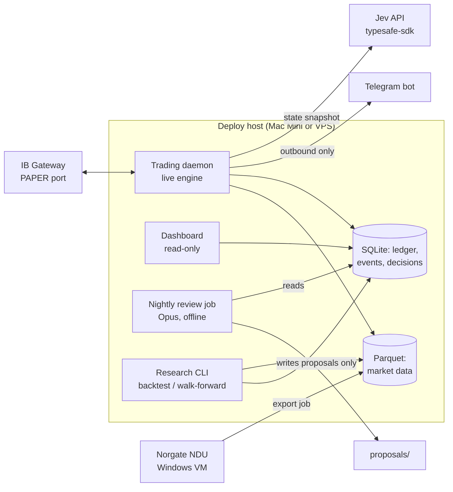

# ARCHITECTURE — Micro Commodity Trend Bot (PAPER ONLY)

Status: **Gate 2 (architecture) — DRAFT, awaiting approval.** No plan or code until approved.
Source of truth: [`spec.md`](spec.md) (Gate 1 approved 2026-10-01). Where this document and the spec disagree, the spec wins and this document is wrong.

---

## 0. Design principles

1. **One deterministic core, two drivers.** Indicators, state snapshots, signals, sizing, risk checks and roll scheduling are pure functions in one package (`core`). The backtester and the live engine both call the *same* functions. No re-implementation of strategy logic anywhere else. This is the main defence against backtest/live drift.
2. **Fail closed.** Any missing, stale, malformed or unreachable input (calendar, Jev, FX rate, contract details, margin, broker connection) blocks *new entries*. Exits, resting stops and rolls keep running.
3. **Models are advisors behind a typed wall.** Jev output is parsed into a strict schema; anything invalid is a veto. Opus never runs inside the trading process and holds no broker credentials.
4. **Paper-only is a constant, not a setting.** Enforced in code at the broker boundary (section 5.1).
5. **Halts are sticky.** Kill switch and flatten-failure states are persisted and survive restarts. Only a human, on the host, clears them.
6. **Point-in-time by construction.** Every data access goes through an `as_of` cut; nothing reads "the whole series".
7. **Price-agnostic maths.** No log returns, no division by price, no `% change`. Distances in ATR units, P&L in points × multiplier. Negative prices are a test fixture, not an edge case.

---

## 1. System context



Separate OS processes, separate responsibilities:

| Process | Runs | Can talk to | Cannot |
|---|---|---|---|
| **Trading daemon** | Always (supervised) | IB Gateway, Jev, Telegram (send), SQLite, Parquet | Edit config, strategy, calendar |
| **Research CLI** | On demand | Parquet, SQLite (results tables) | Reach the broker; read holdout before freeze |
| **Nightly review (Opus)** | Nightly | Reads SQLite/logs; writes `proposals/` | Reach the broker or Jev; edit `strategy.md`, config or limits |
| **Dashboard** | Always | SQLite (read-only connection) | Write anything |
| **Norgate export** | Daily, Windows VM | Norgate NDU → Parquet files | Anything else |

---

## 2. Layers mapped to the spec

| Spec layer | Lives in | Boundary |
|---|---|---|
| Opus 5.5 | `review/` job + human-driven development | Output is a proposal file. A proposal becomes a strategy change only after the research harness runs the full gate *and* the user approves the merge. Max one merged change per week, enforced by a check on `strategy.md` history. |
| Jev | `jev/` adapter, called by the live engine | Input: the state snapshot only. Output: typed answers → `JevVerdict` that can only **veto** or **shrink** (multiplier ∈ [0, 1]). It has no type that can express "enter". |
| Deterministic code | everything else | Owns state, rolls, thresholds, sizing, risk, orders. |

---

## 3. Package layout (proposed)

```
config/
  settings.toml          # equity £200,000, base GBP, markets, flags (kelly_enabled=false)
  events.csv             # spec 8a — human-approved, bot read-only
strategy.md              # frozen strategy, with one fenced YAML block the code parses
src/bot/
  core/                  # PURE. no I/O, no clock, no network
    indicators.py        # ATR, rolling highs/lows, MAs, slopes, realized vol (point-based)
    snapshot.py          # StateSnapshot (spec §4)
    signals.py           # baseline entry/exit/trailing stop
    sizing.py            # 0.5% risk sizing, min-equity calc, Kelly stub (disabled)
    risk.py              # pre-trade checks, tail check, limits → RiskDecision
    rolls.py             # roll date = 10 trading days before min(FND, LTD); FND optional
    calendar.py          # event-block rule + staleness guard
    fx.py                # USD↔GBP conversion with rate provenance
  data/
    store.py             # Parquet read with mandatory as_of cut
    norgate_export.py    # runs on Windows VM: individual contracts → Parquet
    continuous.py        # our own back-adjusted series using core.rolls
    ibkr_bars.py         # live daily bars + contract details
    reconcile.py         # Norgate vs IBKR overlap check
  broker/
    paper_guard.py       # port + account-ID checks (hard-coded)
    ib_client.py         # ib_async wrapper: connect, reconnect, contracts, margin what-if
    orders.py            # entry + resting stop as one bracket; stop modify; flatten
    positions.py         # broker ↔ ledger reconciliation
  jev/
    questions.py         # the four fixed questions
    client.py            # typesafe-sdk wrapper: timeout, cost/latency logging
    verdict.py           # answers + strategy thresholds → JevVerdict (veto/shrink)
    fake.py              # deterministic fake for tests and backtests
  engine/
    daily_cycle.py       # once-per-bar orchestration (section 4)
    monitor.py           # intraday MTM loop: daily-loss and drawdown triggers
    halt.py              # persisted halt/kill-switch state machine
    ledger.py            # simulated GBP equity from our own fills
  backtest/
    simulator.py         # daily event loop over core, with fill/cost model
    costs.py             # micro commissions, tick slippage, roll cost
    walkforward.py
    gates.py             # spec §5 gates, t-stat, holdout lock
    stress.py            # spec §11 scenarios
  calibration/
    brier.py, reliability.py, bootstrap.py, recalibrate.py
  ops/
    telegram.py          # send-only
    report.py            # daily report
    dashboard/           # read-only web view over SQLite
  review/
    nightly.py           # assembles evidence pack for Opus, writes proposals/
tests/                   # mirrors src/; lookahead, negative-price, paper-guard suites
```

Stack: Python 3.12, `uv`, `pydantic` (schemas), `pandas`/`numpy`, `pytest` + `hypothesis` (property tests for lookahead and negative prices), `ib_async` (maintained successor to `ib_insync`), `typesafe-sdk` (Python ≥3.10; reads `TYPESAFE_API_KEY` from env), SQLite (WAL mode), Parquet via `pyarrow`. Supervisor: `launchd` (Mac) or `systemd` (VPS).

---

## 4. Live daily cycle

CME Globex for these products trades ~17:00–16:00 CT with a one-hour break. The decision runs **inside the break**, on the completed daily bar, and orders go in for the 17:00 CT reopen. The backtest uses the same convention: **signal on bar t close, fill at bar t+1 open** (never at the close that produced the signal).

```
16:00 CT  session closes
16:05     fetch completed daily bars (IBKR) for active contracts → Parquet
          sanity checks: bar present, timestamp < decision time, no gaps
          refresh contract details (multiplier, tick, FND, LTD, hours), FX rate, margin
16:10     per market:
            1. core.snapshot(as_of=now)              → StateSnapshot
            2. core.rolls: roll due?                 → roll orders (exit+re-entry, logged with cost)
            3. core.signals: exit / trailing-stop update for open positions
            4. core.signals: baseline entry?         → candidate (or nothing; Jev not called for entries that don't exist)
            5. jev.client(snapshot)                  → answers (always called once per market per bar, for calibration logging)
            6. jev.verdict(answers, thresholds)      → veto | shrink(k) | pass
            7. core.sizing(candidate, k)             → contracts (rounded down; 0 → skip)
            8. core.risk(all positions + candidate)  → allow | shrink | block, with reasons
16:45     submit: stop modifications first, then exits/rolls, then entries (bracket: entry + resting stop)
17:00     session reopens; fills arrive; ledger + Telegram on each fill
17:30     confirm every open position has a live resting stop at the broker; else → alert + block path
          write daily report
```

Step 5 calls Jev even when there is no candidate so calibration (spec §10) has a decision every bar, not just on rare signals. Cost is 4 markets × ~252 bars ≈ 1,000 calls/year; logged per call.

**Intraday monitor** (`engine/monitor.py`, every 60 s while connected): marks positions to market in GBP against the simulated ledger. Daily loss ≥ 2% → halt new entries. Drawdown from peak ≥ 15% → kill switch (flatten all, halt, alert). Resting stops do the per-position protection; the monitor is the portfolio-level backstop.

---

## 5. Safety mechanisms

### 5.1 Paper-only guard (`broker/paper_guard.py`)
- Paper port is a module constant; `connect()` refuses any other port before opening a socket.
- After connect: read managed accounts. Halt unless every account ID matches the paper pattern **and** IBKR's account-type field (where exposed) confirms paper. The `DU` prefix is verified against the connected account during the first paper smoke test and the evidence is logged; the check is not removed after.
- No live-account code path exists: `orders.py` takes a `PaperAccount` object that only `paper_guard` can construct.
- Tests: wrong port, non-`DU` account, mixed accounts → all refuse to start.

### 5.2 Equity and FX
- Equity is the **simulated ledger**: £200,000 configured + realized/unrealized P&L from our own fills, converted at the IBKR FX rate at the time, rate logged per conversion. The IBKR paper balance is never used for sizing (it defaults to a different amount and currency).
- Margin: per-order IBKR what-if margin (USD) → GBP → checked against 30% of ledger equity.

### 5.3 Risk gate (`core/risk.py`)
Single function, called before every *new-risk* order, returns `allow | shrink(n) | block` with every reason attached. Checks, in order: halt state · calendar block · staleness guard · per-market cap (gold+silver share one cap of 2) · margin < 30% · notional ≤ 1.5× · tail check (< 5% of equity) · stop distance present. Exits, stop moves and flattens never go through the entry gate.

### 5.4 Halt state machine (`engine/halt.py`)
States: `RUNNING → ENTRIES_HALTED (daily loss / calendar stale / broker unconfirmed) → KILLED (drawdown / flatten failed)`. Persisted in SQLite; on startup the daemon loads it before connecting. `ENTRIES_HALTED` for daily loss auto-clears next session; `KILLED` and flatten-failure clear **only** via a CLI command on the host, logged with who/when. Flatten and stop-modify rejections enter a retry loop with alert on each attempt until the broker confirms flat/accepted.

### 5.5 Trust boundaries
- Telegram is **send-only**. No inbound commands; nothing a message says can change state.
- Jev answers are data. Parsed with pydantic; out-of-range, missing, timeout, or SDK error → veto, logged.
- No headline or news feed is ingested by the trading daemon at all.
- Secrets: `.env` holds `TYPESAFE_API_KEY` and the Telegram token, gitignored, user-entered. IBKR login/2FA is never stored or automated; Gateway is logged in by the user. If IBKR forces a re-auth (e.g. weekly), the daemon detects "Gateway down / not logged in", alerts, keeps retrying, and blocks entries. Resting stops at the broker stay live meanwhile.

---

## 6. Data architecture

- **Backtest history:** Norgate individual contracts for GC, SI, CL, HG → Parquet, one file per contract. `data/continuous.py` builds our back-adjusted series using `core.rolls` (10 trading days before min(FND, LTD)), so backtest rolls match live rolls. Roll cost is computed from the two contracts' prices on the roll day and logged separately.
- **Live bars:** IBKR daily bars for the active micro contracts.
- **Warm-up for live:** the 200-day lookbacks need history before the first live decision. Proposal: seed from Norgate full-size proxies (point-based indicators are directly comparable since micro and full-size share the price scale), and run `data/reconcile.py` on the overlap — any day where the close differs by more than N ticks is reported, and live is blocked until the user accepts the report.
- **Point-in-time:** `store.read(symbol, as_of)` is the only reader; it drops rows with timestamp ≥ `as_of`. Lookahead test: compute all snapshots, then mutate/shift every future row and recompute — every past snapshot must be bit-identical (property test with `hypothesis`).
- **Holdout lock:** the research harness holds a `DEV_END` date. Any read past it raises unless a `freeze` record exists (hash of `strategy.md` + code commit). The holdout run is one-shot: a second holdout evaluation of a different hash is recorded as such in the results table, so holdout reuse is visible, never silent.
- **Static data at runtime:** multiplier, tick size/value, hours, margin, settlement type, FND, LTD come from IBKR contract details at runtime and are cached with a fetch timestamp; nothing is hardcoded. Backtests use multipliers/ticks recorded from IBKR into a reviewed snapshot file (they cannot call IBKR historically).

---

## 7. Backtest and evaluation

- **Simulator** runs the same `core` functions bar by bar. Fill model: entries/exits at next open; resting stops fill at `min(stop, open)` for longs when the market gaps through (spec "gaps through stops"); limit-locked days modelled as no exit possible that session; micro commissions; N ticks slippage per side; roll cost per roll.
- **Event calendar** applied historically for the full window (requires the historical `events.csv` back to the data start — part of the calendar drafting work).
- **Walk-forward** inside the development window only.
- **Gates** (`backtest/gates.py`) are code, with thresholds as constants copied from the spec; a test asserts they equal the spec values. The harness writes numbers to a results table; no model writes or interprets the pass/fail.
- **Stress tests** (spec §11) are fixed scenarios in `backtest/stress.py`, reported in GBP loss and % equity.
- **If nothing passes:** the harness writes the result into `strategy.md` as "no strategy approved" and the live engine refuses to place entries without an approved strategy block.

---

## 8. Storage

| Store | Contents |
|---|---|
| Parquet (`data/`) | Contract-level daily bars (Norgate, IBKR), continuous series |
| SQLite `bot.db` | Append-only `events` (every signal, Jev call, risk decision, order, fill, roll, alert, halt transition), `ledger`, `positions`, `jev_decisions` (+ realized outcomes for calibration), `halt_state`, `backtest_results` |
| Files | `config/`, `strategy.md`, `proposals/` (Opus output), daily reports |

Dashboard and daily report are views over `events` — "every signal, probabilities, confidence, action, result" is a query, not a separate log.

---

## 9. Testing strategy (failing test first, per module)

- Unit tests per `core` module, including negative-price fixtures (Apr 2020 CL) for every indicator, signal, sizing and risk function.
- Property tests: lookahead invariance; sizing never exceeds 0.5% risk; risk gate never allows an order that a single-check-alone would block.
- Spec-conformance tests: constants (risk %, caps, gates, roll days, staleness 60 days) asserted equal to spec values.
- Broker tests against a fake IB client; then a scripted **paper smoke test** against the real Gateway (connect, guard, contract details, what-if margin, bracket order, stop modify, flatten, one roll).
- Jev tests against `jev/fake.py`; one recorded live call validates the schema.

---

## 10. Decisions needed from you before Gate 2 can close

1. **Norgate is Windows-only.** Norgate Data Updater requires Windows 10/11; the `norgatedata` Python package only works where NDU runs (Mac/Linux need a Windows VM; WSL2 with mirrored networking also works). Proposal: run NDU + a small export script in a Windows VM (Parallels/UTM on the Mac Mini, or a Windows box), exporting Parquet files that everything else consumes. The trading daemon never depends on Norgate — live bars come from IBKR. **Approve this split, or choose a Windows deploy host?**

2. **Jev cannot be honestly backtested.** Jev was released in September 2026; its training data almost certainly includes the 2008–2026 history we would replay, so historical Jev answers would contain lookahead we can't remove. Cost and rate limits aside, a backtested Jev filter would look better than it is. Proposal:
   - The §5 gates are run on the **baseline without Jev**. That is what gets frozen.
   - Jev runs **forward only** on paper, logged every bar, initially in **shadow mode** (logged, never applied) until calibration (§10 of spec) has enough data; Jev thresholds in `strategy.md` start as "shadow".
   - Switching Jev from shadow to active is a strategy change and goes through the weekly-change rule.
   **Approve, or do you want Jev active (veto/shrink) from day one of paper trading?**

3. **Fill convention:** signal on the daily close, order at the next session open (17:00 CT), same in backtest and live. Approve?

4. **AgenKit:** I could not verify an install source. Proposal: don't use it. The approval gates live in the repo (`docs/spec.md`, `docs/architecture.md`, then `docs/plan.md`), each change is a branch + PR, tests run in CI. Approve?

5. **Historical GBP/USD:** backtests need a daily FX series back to ~2005 to report GBP P&L and size in GBP. Options: Norgate forex/currency-futures data if the trial includes it (preferred, single vendor), or a free central-bank series (Bank of England publishes daily spot rates). Which?

6. **Telegram send-only, halt reset on the host only.** No remote "resume" command. Approve? (Trade-off: you need SSH/screen access to the host to clear a kill switch.)

7. **IBKR re-authentication:** IB Gateway can require a manual re-login (with 2FA) periodically. Since the spec forbids automating login, the bot will alert and block entries until you log in again; resting stops remain at the broker. Accept this operational burden?

Once these are answered I'll update this document, mark it approved, and only then start Gate 3 (plan).
